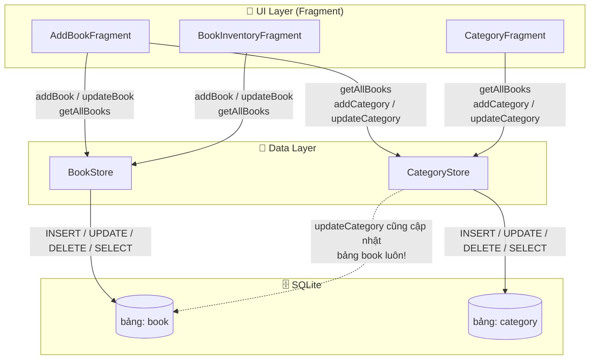
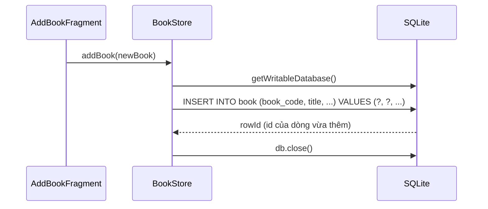
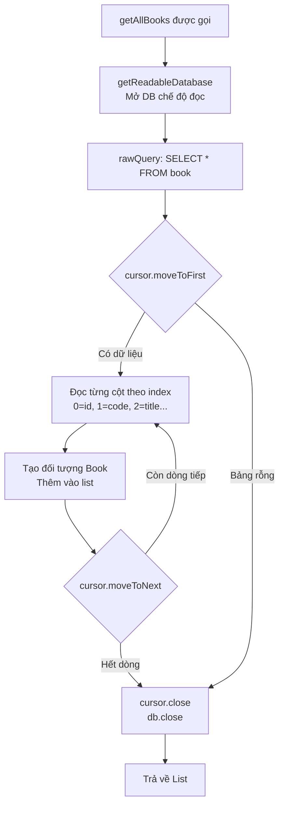
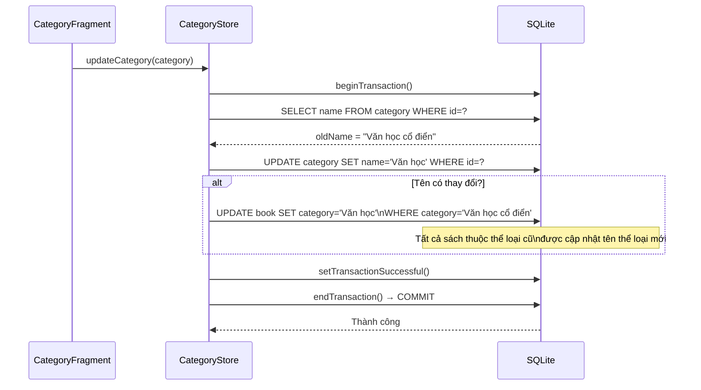
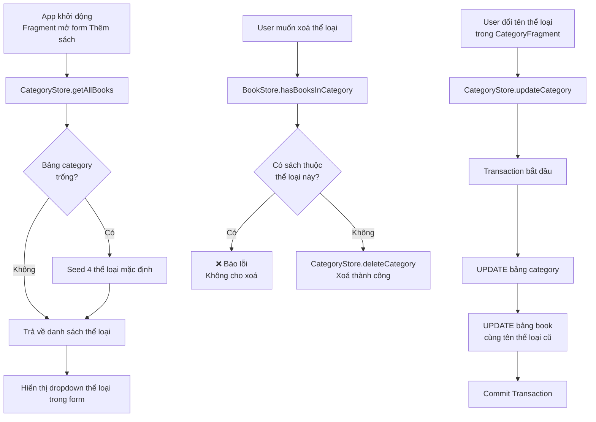

# 🗄️ `BookStore` & `CategoryStore` — Data Layer

> **Vị trí:** `com.example.quan_ly_cua_hang_sach_cu/`  
> **Vai trò:** Tầng truy cập dữ liệu — thực hiện toàn bộ thao tác CRUD lên SQLite  
> **Kiến trúc:** Đây là tầng **Data Layer** (tương tự Repository trong MVVM), nhận `SQLiteOpenHelper` qua constructor và thực thi SQL trực tiếp.

---

## 1. Vị trí trong kiến trúc tổng thể



---

## 2. `BookStore` — Quản lý dữ liệu sách

### Cấu trúc bảng `book`

```java
static final String CREATE_TABLE =
    "CREATE TABLE book (" +
    "id INTEGER PRIMARY KEY AUTOINCREMENT, " +
    "book_code TEXT, " +
    "title TEXT, " +
    "author TEXT, " +
    "category TEXT, " +      // ← Lưu TÊN thể loại, không phải id
    "condition TEXT, " +
    "condition_percent INTEGER, " +
    "price TEXT, " +
    "original_price TEXT, " +
    "image_uri TEXT)";
```

| Cột                 | Kiểu       | Ghi chú                                          |
| ------------------- | ---------- | ------------------------------------------------ |
| `id`                | INTEGER PK | Tự tăng, khóa chính                              |
| `book_code`         | TEXT       | Mã sách (ISBN hoặc `MS-XXXXX`)                   |
| `title`             | TEXT       | Tên sách                                         |
| `author`            | TEXT       | Tác giả                                          |
| `category`          | TEXT       | **Lưu tên thể loại** (không phải foreign key id) |
| `condition`         | TEXT       | Tình trạng: `"Tốt"`, `"Khá"`, `"Trung bình"`     |
| `condition_percent` | INTEGER    | Phần trăm tình trạng: 90, 75, 60                 |
| `price`             | TEXT       | Giá bán đã format: `"65.000 đ"`                  |
| `original_price`    | TEXT       | Giá gốc, có thể `null`                           |
| `image_uri`         | TEXT       | URI ảnh bìa, có thể `null`                       |

---

### `addBook()` — Thêm sách mới

```java
public void addBook(Book book) {
    SQLiteDatabase db = helper.getWritableDatabase(); // Mở DB chế độ ghi
    db.insert(TABLE, null, bookValues(book));          // Chèn 1 dòng mới
    db.close();                                        // Đóng kết nối
}
```



→ Dữ liệu được đóng gói bởi hàm helper `bookValues()`:

```java
private ContentValues bookValues(Book book) {
    ContentValues values = new ContentValues();
    values.put(COLUMN_CODE,             book.getBookCode());
    values.put(COLUMN_TITLE,            book.getTitle());
    values.put(COLUMN_AUTHOR,           book.getAuthor());
    values.put(COLUMN_CATEGORY,         book.getCategory());
    values.put(COLUMN_CONDITION,        book.getCondition());
    values.put(COLUMN_CONDITION_PERCENT,book.getConditionPercent());
    values.put(COLUMN_PRICE,            book.getPrice());
    values.put(COLUMN_ORIGINAL_PRICE,   book.getOriginalPrice());
    values.put(COLUMN_IMAGE_URI,        book.getImageUri());
    return values;
}
```

→ `ContentValues` là kiểu Map của Android để truyền dữ liệu vào SQL — tương tự `{column: value}`.

---

### `updateBook()` — Cập nhật sách

```java
public int updateBook(Book book) {
    SQLiteDatabase db = helper.getWritableDatabase();
    return db.update(
        TABLE,                          // Tên bảng
        bookValues(book),               // Dữ liệu mới
        COLUMN_ID + "=?",              // Điều kiện WHERE
        new String[]{String.valueOf(book.getId())} // Giá trị cho ?
    );
}
```

→ Chỉ cập nhật **đúng dòng có `id` khớp**, trả về số dòng đã thay đổi (thường là 1).  
→ Dùng `"=?"` và truyền giá trị riêng — đây là cách viết **SQL parameterized** để tránh SQL Injection.

---

### `deleteBook()` — Xoá sách

```java
public int deleteBook(Book book) {
    SQLiteDatabase db = helper.getWritableDatabase();
    return db.delete(TABLE, COLUMN_ID + "=?",
        new String[]{String.valueOf(book.getId())});
}
```

→ Tương tự update — xoá đúng 1 dòng theo `id`.

---

### `getAllBooks()` — Lấy toàn bộ danh sách sách

```java
public List<Book> getAllBooks() {
    List<Book> list = new ArrayList<>();
    SQLiteDatabase db = helper.getReadableDatabase(); // Chỉ cần đọc → dùng Readable
    Cursor cursor = db.rawQuery("SELECT * FROM " + TABLE, null);

    if (cursor.moveToFirst()) {          // Di chuyển đến dòng đầu tiên
        do {
            Book book = new Book();
            book.setId(cursor.getInt(0));         // Cột 0: id
            book.setBookCode(cursor.getString(1)); // Cột 1: book_code
            book.setTitle(cursor.getString(2));    // Cột 2: title
            // ... đọc tiếp các cột
            list.add(book);
        } while (cursor.moveToNext());   // Lặp đến hết dòng
    }
    cursor.close(); // ⚠️ Phải close Cursor để giải phóng bộ nhớ
    db.close();
    return list;
}
```



> ⚠️ **Điểm cần chú ý:** Đọc cột theo **index số** (`cursor.getInt(0)`, `cursor.getString(1)`...) thay vì tên cột — nếu thêm/đổi thứ tự cột trong `CREATE_TABLE` thì code này sẽ đọc sai dữ liệu. Nên dùng `cursor.getColumnIndex(COLUMN_ID)` cho an toàn hơn.

---

### `getAllBooks()` — Lấy danh sách hoặc tạo dữ liệu mẫu

```java
public List<Book> getAllBooks() {
    List<Book> list = getAllBooks();
    if (list.isEmpty()) {
        addBook(new Book("MS-00124", "Nỗi Buồn Chiến Tranh", "Bảo Ninh", ...));
        addBook(new Book("MS-00208", "Vũ Trụ Trong Vỏ Hạt Dẻ", "Stephen Hawking", ...));
        addBook(new Book("MS-00315", "Steve Jobs - Tiểu Sử Chính Thức", ...));
        addBook(new Book("MS-00412", "Dế Mèn Phiêu Lưu Ký", "Tô Hoài", ...));
        list = getAllBooks(); // Gọi lại để lấy list đã có id từ DB
    }
    return list;
}
```

→ Pattern **"seed on empty"**: Nếu bảng trống (lần đầu mở app), tự chèn 4 cuốn sách mẫu để app không hiển thị màn hình trống.

---

### `hasBooksInCategory()` — Kiểm tra thể loại có sách không

```java
public boolean hasBooksInCategory(String categoryName) {
    SQLiteDatabase db = helper.getReadableDatabase();
    Cursor cursor = db.rawQuery(
        "SELECT COUNT(*) FROM book WHERE category COLLATE NOCASE = ?",
        new String[]{categoryName}
    );
    int count = 0;
    if (cursor.moveToFirst()) count = cursor.getInt(0);
    cursor.close();
    db.close();
    return count > 0;
}
```

→ Dùng `COUNT(*)` thay vì lấy toàn bộ list rồi đếm — **hiệu quả hơn nhiều** với dữ liệu lớn.  
→ `COLLATE NOCASE` so sánh không phân biệt chữ hoa/thường: `"văn học"` = `"Văn Học"`.  
→ **Mục đích:** Ngăn người dùng xoá thể loại đang có sách bên trong (gọi từ `CategoryFragment`).

---

## 3. `CategoryStore` — Quản lý dữ liệu thể loại

### Cấu trúc bảng `category`

```java
static final String CREATE_TABLE =
    "CREATE TABLE category (" +
    "id INTEGER PRIMARY KEY AUTOINCREMENT, " +
    "name TEXT)";
```

Bảng rất đơn giản, chỉ có 2 cột: `id` và `name`.

---

### `addCategory()` và `deleteCategory()` — Thêm / Xoá thể loại

```java
public void addCategory(Category category) {
    SQLiteDatabase db = helper.getWritableDatabase();
    ContentValues values = new ContentValues();
    values.put(COLUMN_NAME, category.getName());
    db.insert(TABLE, null, values);
    db.close();
}

public int deleteCategory(Category category) {
    SQLiteDatabase db = helper.getWritableDatabase();
    return db.delete(TABLE, COLUMN_ID + "=?",
        new String[]{String.valueOf(category.getId())});
}
```

→ Logic đơn giản tương tự `BookStore`. Tuy nhiên, `deleteCategory` **không tự động xoá sách** thuộc thể loại đó — việc kiểm tra được handle bởi `BookStore.hasBooksInCategory()` trước khi cho phép xoá.

---

### `updateCategory()` — Đặc biệt: Cập nhật tên thể loại + đồng bộ sang bảng `book`

Đây là hàm **phức tạp nhất** trong toàn bộ data layer:

```java
public int updateCategory(Category category) {
    SQLiteDatabase db = helper.getWritableDatabase();
    db.beginTransaction();                              // Bắt đầu transaction
    try {
        // Bước 1: Lấy tên cũ của thể loại
        String oldName = null;
        Cursor cursor = db.rawQuery(
            "SELECT name FROM category WHERE id=?",
            new String[]{String.valueOf(category.getId())});
        if (cursor.moveToFirst()) oldName = cursor.getString(0);
        cursor.close();

        // Bước 2: Cập nhật tên mới trong bảng category
        ContentValues values = new ContentValues();
        values.put(COLUMN_NAME, category.getName());
        int rows = db.update(TABLE, values, COLUMN_ID + "=?",
            new String[]{String.valueOf(category.getId())});

        // Bước 3: Nếu tên thực sự thay đổi → cập nhật luôn bảng book
        if (oldName != null && !oldName.equals(category.getName())) {
            ContentValues bookValues = new ContentValues();
            bookValues.put(BookStore.COLUMN_CATEGORY, category.getName());
            db.update(BookStore.TABLE, bookValues,
                BookStore.COLUMN_CATEGORY + "=?", new String[]{oldName});
        }

        db.setTransactionSuccessful(); // Đánh dấu transaction thành công
        return rows;

    } finally {
        db.endTransaction(); // Luôn kết thúc transaction dù thành công hay lỗi
    }
}
```



**Tại sao cần Transaction?**

| Không dùng Transaction                                                              | Dùng Transaction                                                     |
| ----------------------------------------------------------------------------------- | -------------------------------------------------------------------- |
| Nếu update `category` thành công nhưng update `book` lỗi → 2 bảng **không đồng bộ** | Nếu bất kỳ bước nào lỗi → **rollback toàn bộ**, không có gì thay đổi |
| Dữ liệu bị lệch: thể loại đổi tên nhưng sách vẫn giữ tên cũ                         | Dữ liệu luôn nhất quán                                               |

→ **Transaction** đảm bảo nguyên tắc "tất cả hoặc không có gì" (all-or-nothing).

---

### `getAllBooks()` — Seed dữ liệu mẫu cho thể loại

```java
public List<Category> getAllBooks() {
    List<Category> list = getAllCategories();
    if (list.isEmpty()) {
        addCategory(new Category("Văn học cổ điển & Hiện đại"));
        addCategory(new Category("Khoa học & Vũ trụ"));
        addCategory(new Category("Lịch sử & Triết học"));
        addCategory(new Category("Tiểu sử & Danh nhân"));
        list = getAllCategories();
    }
    return list;
}
```

→ Tương tự `BookStore.getAllBooks()` — đảm bảo dropdown thể loại trong form thêm sách luôn có dữ liệu ngay từ lần đầu mở app.

---

## 4. So sánh `BookStore` vs `CategoryStore`

| Tiêu chí         | BookStore                                    | CategoryStore                                             |
| ---------------- | -------------------------------------------- | --------------------------------------------------------- |
| Bảng quản lý     | `book` (10 cột)                              | `category` (2 cột)                                        |
| Hàm CRUD         | add, update, delete, getAll                  | add, update, delete, getAll                               |
| Seed dữ liệu     | 4 cuốn sách mẫu                              | 4 thể loại mẫu                                            |
| Điểm đặc biệt    | `hasBooksInCategory()` để kiểm tra ràng buộc | `updateCategory()` dùng **Transaction** để đồng bộ 2 bảng |
| Dùng Transaction | ❌ Không                                     | ✅ Có (trong `updateCategory`)                            |

---

## 5. Luồng hoạt động kết hợp



---

## 6. Điểm đáng chú ý

### ✅ Điểm tốt

- `updateCategory()` dùng **Transaction** đúng cách — đảm bảo dữ liệu nhất quán giữa 2 bảng.
- `hasBooksInCategory()` dùng `COUNT(*)` thay vì load toàn bộ list — tối ưu hiệu năng.
- `COLLATE NOCASE` trong query giúp so sánh tên không phân biệt hoa/thường.
- Tách rõ schema (`CREATE_TABLE`) ra khỏi logic — `DatabaseHelper` chỉ gọi tạo bảng, còn định nghĩa nằm trong Store tương ứng.

### ⚠️ Điểm có thể cải thiện

**1. Đọc Cursor theo index dễ lỗi:**

```java
// Hiện tại (dễ sai nếu đổi thứ tự cột):
book.setId(cursor.getInt(0));
book.setTitle(cursor.getString(2));

// Nên dùng (an toàn hơn):
book.setId(cursor.getInt(cursor.getColumnIndexOrThrow(COLUMN_ID)));
book.setTitle(cursor.getString(cursor.getColumnIndexOrThrow(COLUMN_TITLE)));
```

**2. Category lưu tên thay vì foreign key:**

```java
// Hiện tại: book.category = "Văn học" (TEXT)
// Rủi ro: Nếu đồng bộ thất bại, sách có thể trỏ về thể loại không tồn tại

// Tốt hơn: book.category_id = 1 (INTEGER, foreign key)
// → Đảm bảo toàn vẹn dữ liệu ở tầng DB thay vì xử lý thủ công trong code
```

**3. Không có xử lý lỗi khi DB fail:**

```java
// Nên bọc trong try-catch và trả về kết quả rõ ràng:
public boolean addBook(Book book) {
    try {
        SQLiteDatabase db = helper.getWritableDatabase();
        long result = db.insert(TABLE, null, bookValues(book));
        db.close();
        return result != -1; // -1 nghĩa là insert thất bại
    } catch (Exception e) {
        Log.e("BookStore", "addBook failed", e);
        return false;
    }
}
```
