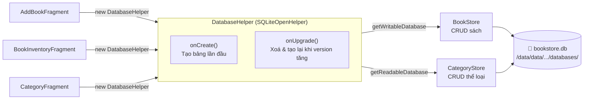
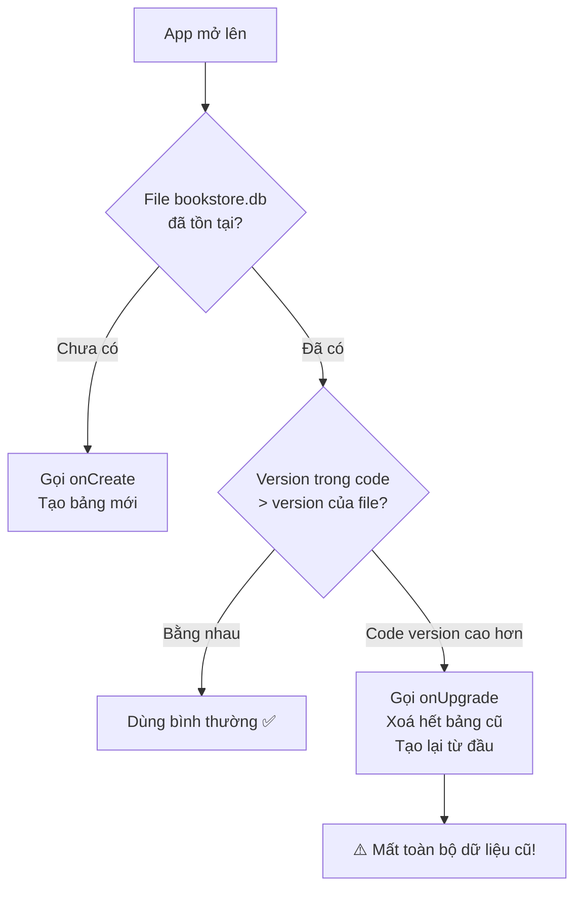
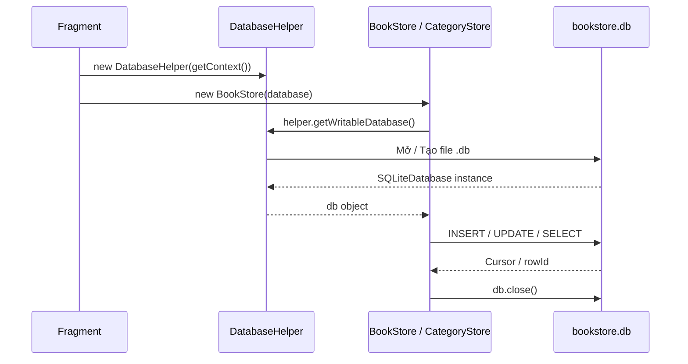

# 🔍 `DatabaseHelper` — DB Helper (SQLiteOpenHelper)

**Chức năng chính:** Là "cổng vào" duy nhất của toàn bộ database SQLite trong app. Nó tạo ra file `.db`, khởi tạo các bảng, và xử lý việc nâng cấp schema khi app update version.

> **File:** `app/src/main/java/com/example/quan_ly_cua_hang_sach_cu/DatabaseHelper.java`  
> **Kế thừa từ:** `SQLiteOpenHelper` (Android SDK)

---

## 1. Vị trí trong kiến trúc



---

## 2. Giải thích từng phần

### Khai báo class

```java
public class DatabaseHelper extends SQLiteOpenHelper {
    public static final String DATABASE_NAME = "bookstore.db";
    private static final int DATABASE_VERSION = 2;
```

| Thuộc tính | Giá trị | Ý nghĩa |
|---|---|---|
| `DATABASE_NAME` | `"bookstore.db"` | Tên file SQLite lưu trong bộ nhớ máy |
| `DATABASE_VERSION` | `2` | Phiên bản schema hiện tại. Khi tăng số này, Android tự gọi `onUpgrade()` |

> `SQLiteOpenHelper` là class của Android giúp quản lý vòng đời database: tạo mới nếu chưa có, nâng cấp nếu version thay đổi.

---

### `onCreate()` — Chạy 1 lần duy nhất khi cài app

```java
@Override
public void onCreate(SQLiteDatabase db) {
    db.execSQL(CategoryStore.CREATE_TABLE); // Tạo bảng category trước
    db.execSQL(BookStore.CREATE_TABLE);     // Tạo bảng book sau
}
```

→ Phương thức này chỉ chạy **một lần duy nhất** — khi file `bookstore.db` chưa tồn tại (tức là lần đầu cài app hoặc sau khi xoá dữ liệu app).  
→ Thứ tự tạo bảng có ý nghĩa: `category` phải tạo trước `book` vì `book` tham chiếu đến thể loại.  
→ SQL thực tế được định nghĩa trong từng Store:

```java
// BookStore.CREATE_TABLE tương đương:
"CREATE TABLE book (
    id INTEGER PRIMARY KEY AUTOINCREMENT,
    book_code TEXT, title TEXT, author TEXT,
    category TEXT, condition TEXT,
    condition_percent INTEGER,
    price TEXT, original_price TEXT, image_uri TEXT
)"
```

---

### `onUpgrade()` — Chạy khi `DATABASE_VERSION` tăng lên

```java
@Override
public void onUpgrade(SQLiteDatabase db, int oldVersion, int newVersion) {
    db.execSQL("DROP TABLE IF EXISTS " + BookStore.TABLE);
    db.execSQL("DROP TABLE IF EXISTS " + CategoryStore.TABLE);
    onCreate(db); // Tạo lại từ đầu
}
```

→ Được Android tự gọi khi phát hiện `DATABASE_VERSION` trong code **lớn hơn** version của file `.db` đang có trên máy.



> ⚠️ **Điểm quan trọng:** Cách `onUpgrade` hiện tại là **xoá toàn bộ bảng rồi tạo lại** — nghĩa là mỗi lần tăng `DATABASE_VERSION`, tất cả dữ liệu sách đang lưu sẽ bị mất. Đây là cách đơn giản phù hợp lúc phát triển, nhưng khi app đưa vào thực tế nên thay bằng `ALTER TABLE` để giữ lại dữ liệu.

---

### Constructor

```java
public DatabaseHelper(Context context) {
    super(context, DATABASE_NAME, null, DATABASE_VERSION);
}
```

→ Truyền vào `Context` (thường là `getContext()` từ Fragment) để Android biết lưu file `.db` vào đúng thư mục private của app:  
`/data/data/com.example.quan_ly_cua_hang_sach_cu/databases/bookstore.db`

---

## 3. Cách các Fragment sử dụng DatabaseHelper



---

## 4. Tóm tắt vai trò

| Câu hỏi | Trả lời |
|---|---|
| **File `.db` lưu ở đâu?** | `/data/data/com.example.quan_ly_cua_hang_sach_cu/databases/bookstore.db` |
| **onCreate() chạy khi nào?** | **Chỉ 1 lần** — khi cài app / xoá data app |
| **onUpgrade() chạy khi nào?** | Khi tăng `DATABASE_VERSION` trong code |
| **Chạy onUpgrade thì sao?** | ⚠️ Xoá hết dữ liệu, tạo lại bảng trống |
| **Ai gọi DatabaseHelper?** | `AddBookFragment`, `BookInventoryFragment`, `CategoryFragment` — mỗi Fragment tự `new DatabaseHelper()` |

---

## 5. Điểm đáng chú ý

### ✅ Điểm tốt
- Tách biệt rõ ràng: `DatabaseHelper` chỉ lo việc khởi tạo DB, còn `BookStore` / `CategoryStore` lo CRUD — đúng nguyên tắc **Single Responsibility**.
- Dùng `CREATE_TABLE` static từ các Store, giúp định nghĩa schema tập trung tại nơi sử dụng.

### ⚠️ Điểm có thể cải thiện

**1. Nên dùng Singleton:**
```java
// Thay vì mỗi Fragment new DatabaseHelper()...
// Nên thêm pattern Singleton:
private static DatabaseHelper instance;

public static synchronized DatabaseHelper getInstance(Context context) {
    if (instance == null) {
        instance = new DatabaseHelper(context.getApplicationContext());
    }
    return instance;
}
```
→ Tránh mở nhiều kết nối DB cùng lúc, tiết kiệm tài nguyên.

**2. onUpgrade nên dùng ALTER TABLE thay vì DROP:**
```java
// Thay vì xoá toàn bộ:
@Override
public void onUpgrade(SQLiteDatabase db, int oldVersion, int newVersion) {
    if (oldVersion < 2) {
        // Chỉ thêm cột mới, giữ nguyên dữ liệu cũ
        db.execSQL("ALTER TABLE book ADD COLUMN original_price TEXT");
    }
}
```
→ Người dùng không bị mất dữ liệu khi cập nhật app.
