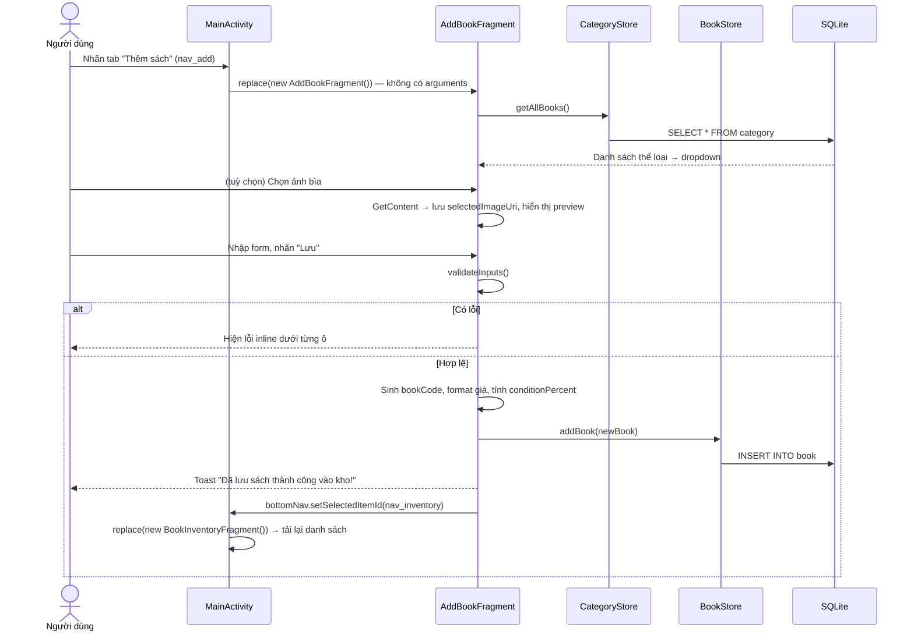
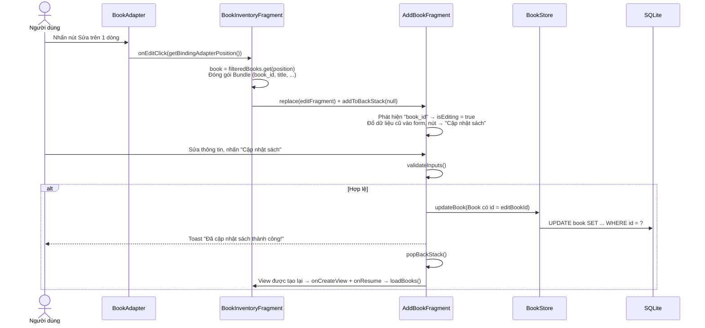
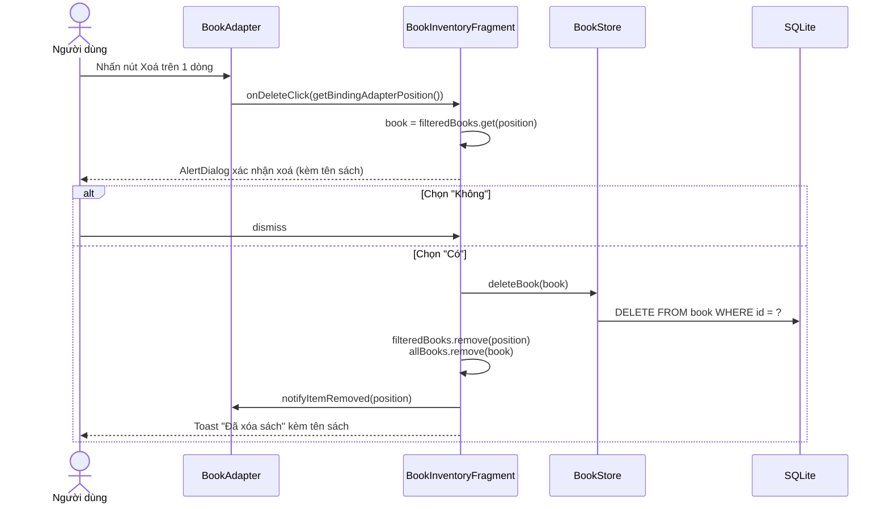

# Luồng Thêm – Sửa – Xoá Sách

> Tài liệu giải thích chi tiết từng luồng nghiệp vụ trên bảng `book` của ứng dụng **Quản lý Cửa hàng Sách cũ**.
> Cập nhật: 2026-11-08 (theo commit `23af9b5`). Số dòng tham chiếu theo mã nguồn tại thời điểm viết.
> Xem thêm: [kien-truc-tong-the.md](kien-truc-tong-the.md) · [luong-them-sach.md](luong-them-sach.md) · [luong-them-sua-xoa-the-loai.md](luong-them-sua-xoa-the-loai.md)

---

## 0. Thành phần dùng chung

| Thành phần              | File                                   | Vai trò                                                                                        |
| ----------------------- | -------------------------------------- | ---------------------------------------------------------------------------------------------- |
| `MainActivity`          | `MainActivity.java`                    | Chứa `fragment_container` + `BottomNavigationView`, đổi tiêu đề qua `setScreenTitle()`         |
| `BookInventoryFragment` | `fragments/BookInventoryFragment.java` | Màn hình **Trang chủ** – điểm bắt đầu luồng **Sửa** và **Xoá**                                 |
| `AddBookFragment`       | `fragments/AddBookFragment.java`       | Màn hình form, dùng chung cho **Thêm** và **Sửa** (phân biệt bằng cờ `isEditing`)              |
| `BookAdapter`           | `adapters/BookAdapter.java`            | Hiển thị từng dòng sách, bắt sự kiện nút Sửa/Xoá và báo về Fragment qua `OnBookActionListener` |
| `BookStore`             | `BookStore.java`                       | Thực hiện thao tác SQL: `addBook`, `updateBook`, `deleteBook`, `getAllBooks`                   |
| `DatabaseHelper`        | `DatabaseHelper.java`                  | Mở file `bookstore.db`                                                                         |
| `Book`                  | `models/Book.java`                     | Đối tượng dữ liệu (POJO)                                                                       |

Hàm `BookStore.bookValues(Book)` (`BookStore.java:113`) chuyển `Book` thành `ContentValues` và được dùng chung cho cả `addBook` lẫn `updateBook`. Cột `id` **không** nằm trong `ContentValues` vì do SQLite tự tăng (AUTOINCREMENT).

---

## 1. Luồng THÊM sách

### 1.1 Sơ đồ tuần tự



### 1.2 Các bước chi tiết

**Bước 1 – Mở màn hình** (`MainActivity.java`)

- Khi nhấn tab `nav_add`, Activity tạo một `AddBookFragment` **mới** và gọi `replace` vào `fragment_container`. Transaction này không được thêm vào back stack.
- Vì không có `arguments`, điều kiện `getArguments().containsKey("book_id")` (`AddBookFragment.java:196`) sai, nên `isEditing = false`.

**Bước 2 – Khởi tạo form** (`AddBookFragment.onCreateView`)

- Tạo `DatabaseHelper`, `BookStore`, `CategoryStore`.
- Gắn dấu `*` đỏ cho các trường bắt buộc bằng `Html.fromHtml`.
- Gắn `TextWatcher` để **ẩn thông báo lỗi** ngay khi người dùng gõ lại.
- Dropdown **Thể loại** lấy dữ liệu từ `categoryStore.getAllBooks()`. Dropdown **Tình trạng** cố định 3 giá trị: `Tốt`, `Khá`, `Trung bình`.

**Bước 3 – Chọn ảnh bìa (tuỳ chọn)** (`AddBookFragment.java:46`)

- `ActivityResultContracts.GetContent()` mở trình chọn ảnh `image/*`.
- Sau khi chọn ảnh, app gọi `takePersistableUriPermission` để cố giữ quyền đọc lâu dài (nếu lỗi thì bỏ qua). Sau đó lưu `uri.toString()` vào `selectedImageUri`.
- Ảnh preview được decode bằng `ImageUtils.decodeSampledBitmapFromUri(..., 300, 400)` để tránh OOM.

**Bước 4 – Validate** (`validateInputs`, `AddBookFragment.java:301`)

| Trường                | Bắt buộc | Thông báo lỗi                   |
| --------------------- | -------- | ------------------------------- |
| Tên sách              | ✔        | "Vui lòng nhập tên sách"        |
| Tác giả               | ✔        | "Vui lòng nhập tên tác giả"     |
| Thể loại              | ✔        | "Vui lòng chọn thể loại"        |
| Tình trạng            | ✔        | "Vui lòng chọn tình trạng sách" |
| Giá bán               | ✔        | "Vui lòng nhập giá bán"         |
| Mã/ISBN, Giá gốc, Ảnh | ✘        | –                               |

Hàm kiểm tra **tất cả** các trường rồi mới trả kết quả, nên người dùng thấy mọi lỗi cùng lúc.

**Bước 5 – Chuẩn hoá dữ liệu** (`AddBookFragment.java:246` trở đi)

- **Mã sách:** nếu ô ISBN trống thì sinh `"MS-" + số ngẫu nhiên 10000–99999`.
- **Giá:** `Long.parseLong` rồi format theo `Locale("vi","VN")` và thêm `" đ"`, ví dụ `65000` thành `"65.000 đ"`. Nếu parse lỗi thì giữ nguyên chuỗi và thêm `" đ"`.
- **Giá gốc:** chỉ format khi người dùng có nhập, nếu không thì là `null`.
- **conditionPercent:** `Tốt → 90`, `Khá → 75`, còn lại `→ 60`.

**Bước 6 – Ghi DB** (`BookStore.addBook`, `BookStore.java:45`)

```java
SQLiteDatabase db = helper.getWritableDatabase();
db.insert(TABLE, null, bookValues(book));   // INSERT INTO book (...) VALUES (...)
db.close();
```

**Bước 7 – Quay về Trang chủ** (`navigateToHome`, `AddBookFragment.java:364`)

- Vì `isEditing = false`, app gọi `bottomNav.setSelectedItemId(R.id.nav_inventory)`. Lệnh này kích hoạt listener của `MainActivity`, listener tạo `BookInventoryFragment` mới và đổi tiêu đề thành "Trang chủ".
- `BookInventoryFragment` gọi `loadBooks()`, sắp xếp theo `id` giảm dần, nên **sách vừa thêm hiện ở đầu danh sách**.

### 1.3 Lưu ý kỹ thuật

- Mã `MS-xxxxx` sinh ngẫu nhiên nên **có thể trùng**, và cột `book_code` không có ràng buộc UNIQUE.
- `GetContent` không đảm bảo URI hỗ trợ persistable permission. Ảnh có thể mất sau khi khởi động lại app; nên dùng `OpenDocument`.
- Không kiểm tra giá trị trả về của `db.insert` (`-1` nếu lỗi), nên app vẫn báo "thành công".
- Chưa kiểm tra giá gốc phải lớn hơn hoặc bằng giá bán.

---

## 2. Luồng SỬA sách

Luồng Sửa **dùng lại** `AddBookFragment` nhưng truyền dữ liệu sách cũ qua `Bundle`, và form chuyển sang chế độ `isEditing = true`.

### 2.1 Sơ đồ tuần tự



### 2.2 Các bước chi tiết

**Bước 1 – Bắt sự kiện trên danh sách** (`BookAdapter.java:112`)

- Nút `btnEdit` gọi `listener.onEditClick(holder.getBindingAdapterPosition())`. Vị trí được lấy **tại thời điểm click** (không dùng tham số `position` của `onBindViewHolder`) để tránh lệch khi danh sách thay đổi.

**Bước 2 – Chuẩn bị dữ liệu** (`BookInventoryFragment.java:73`)

- Lấy `book` từ `filteredBooks` (danh sách đang hiển thị sau khi search/lọc), **không phải** `allBooks`.
- Đóng gói các key: `book_id`, `book_code`, `title`, `author`, `category`, `condition`, `price`, `original_price`, `image_uri`.
- Đổi tiêu đề thành "Chỉnh sửa sách", rồi `replace(...)` kèm `addToBackStack(null)`, nên nút Back hệ thống sẽ đưa người dùng về Trang chủ.

**Bước 3 – Đổ dữ liệu vào form** (`AddBookFragment.java:196`)

- `isEditing = true`, ghi nhớ `editBookId` và `editBookCode`.
- Giá được **lọc chỉ còn chữ số** (`"65.000 đ"` → `"65000"`) trước khi đưa vào `EditText`.
- Dropdown dùng `setText(value, false)` để **không bật bộ lọc gợi ý**.
- Nếu có `image_uri`, app decode và hiển thị ảnh cũ. Nếu lỗi thì dùng icon mặc định `ic_book_open`.
- Nút lưu đổi nhãn thành **"Cập nhật sách"**.

**Bước 4 – Validate & chuẩn hoá:** giống hệt luồng Thêm (mục 1.2, bước 4–5), chỉ khác ở mã sách:

- Ô ISBN trống thì **giữ** `editBookCode` **cũ** (không sinh mã mới).

**Bước 5 – Ghi DB** (`BookStore.updateBook`, `BookStore.java:51`)

```java
db.update(TABLE, bookValues(book), "id=?", new String[]{ String.valueOf(book.getId()) });
```

- Lệnh này **ghi đè toàn bộ cột** (trừ `id`) bằng giá trị trên form.
- Hàm trả về số dòng bị ảnh hưởng, nhưng Fragment không kiểm tra giá trị này.

**Bước 6 – Quay lại** (`navigateToHome`, nhánh `isEditing`)

- Gọi `popBackStack()`, nên `BookInventoryFragment` được tạo lại view và `onResume()` gọi `loadBooks()` + `applyFilters()` để đọc dữ liệu mới từ DB.

### 2.3 Lưu ý kỹ thuật

- **Lỗi dữ liệu tình trạng:** sách seed có `condition = "Rất mới"` (95%). Giá trị này không nằm trong 3 lựa chọn của dropdown, nhưng vẫn được đổ vào form. Khi lưu, công thức tính `conditionPercent` rơi vào nhánh mặc định nên **95% bị đổi thành 60%**.
- **Tiêu đề không nhất quán:** sau khi sửa, tiêu đề được đặt là "Trang chủ" thay vì "Trang chủ".
- **Dữ liệu có thể cũ:** form lấy dữ liệu từ `Bundle` (bản chụp lúc nhấn Sửa), không đọc lại từ DB theo `book_id`.
- **Back stack:** nếu đang ở màn Sửa mà người dùng nhấn sang tab khác trên BottomNav, transaction `replace` mới không vào back stack, trong khi entry Sửa vẫn còn trong back stack. Điều này dễ gây trạng thái điều hướng khó đoán.
- `updateBook` không gọi `db.close()`, trong khi `addBook` thì có, nên cách quản lý kết nối không nhất quán.

---

## 3. Luồng XOÁ sách

### 3.1 Sơ đồ tuần tự



### 3.2 Các bước chi tiết

**Bước 1 – Bắt sự kiện** (`BookAdapter.java:123`)

- Nút `btnDelete` gọi `listener.onDeleteClick(adapterPos)` sau khi đã kiểm tra `NO_POSITION`.

**Bước 2 – Xác nhận** (`BookInventoryFragment.java:101`)

- Kiểm tra `position` hợp lệ, rồi lấy `book` từ `filteredBooks`.
- Hiển thị `AlertDialog` có tên sách. Nếu `title` null thì dùng chữ "sách này".

**Bước 3 – Thực thi khi chọn "Có"**

1. Kiểm tra lại `position < filteredBooks.size()` để phòng trường hợp danh sách đã thay đổi trong lúc dialog mở.
2. `bookStore.deleteBook(book)` chạy `DELETE FROM book WHERE id = ?` (`BookStore.java:56`).
3. Cập nhật **cả hai** danh sách trong bộ nhớ:
   - `filteredBooks.remove(position)`: xoá theo vị trí trong danh sách đang hiển thị.
   - `allBooks.remove(book)`: xoá theo tham chiếu đối tượng, để lần lọc sau sách không xuất hiện lại.
4. `adapter.notifyItemRemoved(position)` tạo hiệu ứng xoá mượt, không phải load lại toàn bộ danh sách.
5. Hiện Toast thông báo.

> Luồng Xoá **không đọc lại DB**: UI được cập nhật trực tiếp trên bộ nhớ (optimistic update) để phản hồi nhanh.

### 3.3 Lưu ý kỹ thuật

- **Xoá cứng (hard delete)**, không có tính năng Hoàn tác (Undo). Nên cân nhắc `Snackbar` có nút "Hoàn tác" hoặc soft delete (cờ `is_deleted`).
- Không kiểm tra giá trị trả về của `deleteBook`. Nếu DB xoá thất bại, UI vẫn mất dòng, gây lệch giữa UI và DB cho đến lần tải lại sau.
- `position` được chụp tại lúc click. Code đã có kiểm tra lại kích thước, nhưng vẫn nên tìm lại vị trí bằng `filteredBooks.indexOf(book)` để chắc chắn đúng phần tử.
- Ảnh bìa (URI) không bị ảnh hưởng vì app chỉ lưu đường dẫn, không sao chép file. Hiện chưa có việc dọn dẹp tài nguyên.
- Xoá sách **không** ảnh hưởng tới bảng `category`. Ngược lại, muốn xoá một thể loại thì phải xoá hết sách thuộc thể loại đó trước (`hasBooksInCategory`).

---

## 4. So sánh nhanh 3 luồng

| Tiêu chí             | Thêm                                     | Sửa                                  | Xoá                                      |
| -------------------- | ---------------------------------------- | ------------------------------------ | ---------------------------------------- |
| Điểm bắt đầu         | Tab BottomNav `nav_add`                  | Nút Sửa trên `item_book`             | Nút Xoá trên `item_book`                 |
| Màn hình xử lý       | `AddBookFragment` (`isEditing=false`)    | `AddBookFragment` (`isEditing=true`) | Dialog trên `BookInventoryFragment`      |
| Truyền dữ liệu       | Không                                    | `Bundle` chứa toàn bộ field          | Đối tượng `Book` trong bộ nhớ            |
| Validate             | ✔ 5 trường bắt buộc                      | ✔ giống Thêm                         | Chỉ xác nhận Có/Không                    |
| Câu lệnh SQL         | `INSERT`                                 | `UPDATE ... WHERE id=?`              | `DELETE ... WHERE id=?`                  |
| Back stack           | Không                                    | Có (`addToBackStack`)                | Không áp dụng                            |
| Cập nhật UI          | Tạo lại `BookInventoryFragment` → đọc DB | `popBackStack` → `onResume` đọc DB   | Sửa trực tiếp list + `notifyItemRemoved` |
| Kiểm tra kết quả SQL | ✘                                        | ✘                                    | ✘                                        |

---

## 5. Đề xuất cải tiến chung cho 3 luồng

1. **Đưa thao tác DB ra background thread** (Executor/Coroutine). Hiện tại `INSERT/UPDATE/DELETE` đều chạy trên main thread.
2. **Tách ViewModel + Repository:** Fragment chỉ gửi sự kiện (`onSaveClicked`, `onDeleteConfirmed`) và observe trạng thái (`Loading / Success / Error`). Cách này giữ được form khi xoay màn hình và cho phép xử lý lỗi SQL đúng nghĩa.
3. **Sửa theo** `bookId`**:** chỉ truyền `bookId` (Navigation Safe Args), màn Sửa tự đọc từ DB để luôn có dữ liệu mới nhất.
4. **Kiểm tra kết quả** `insert/update/delete` và hiển thị lỗi khi thất bại.
5. **Chuẩn hoá dữ liệu:** lưu giá dạng `INTEGER`, tình trạng dạng enum/hằng số, mã sách UNIQUE.
6. **Undo khi xoá** bằng `Snackbar`.
7. **Viết test:** unit test cho validate/format giá, instrumented test cho `BookStore` CRUD.
