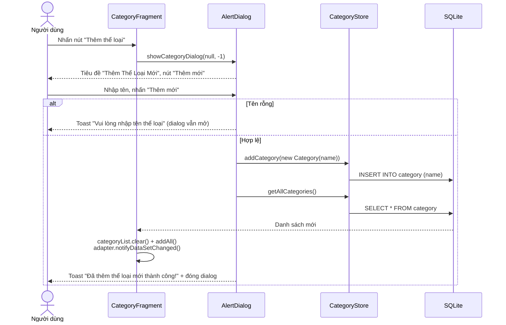
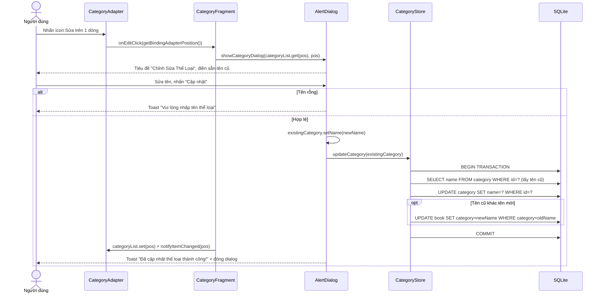
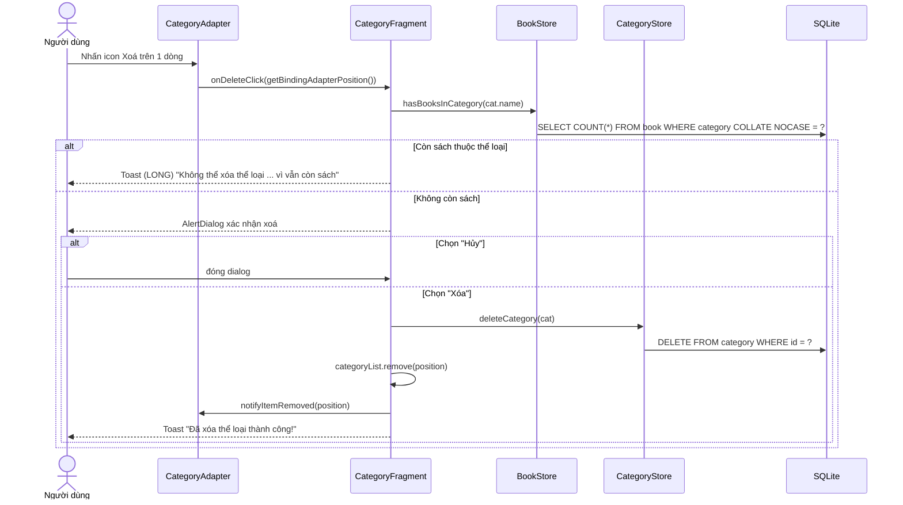

# Luồng Thêm – Sửa – Xoá Thể loại

> Tài liệu giải thích chi tiết từng luồng nghiệp vụ trên bảng `category` của ứng dụng **Quản lý Cửa hàng Sách cũ**.
> Cập nhật: 2026-11-08 (theo commit `23af9b5`). Số dòng tham chiếu theo mã nguồn tại thời điểm viết.
> Xem thêm: [kien-truc-tong-the.md](kien-truc-tong-the.md) · [luong-them-sua-xoa-sach.md](luong-them-sua-xoa-sach.md)

---

## 0. Thành phần dùng chung

| Thành phần | File | Vai trò |
|---|---|---|
| `CategoryFragment` | `fragments/CategoryFragment.java` | Màn hình **Thể loại**: hiển thị danh sách, điều phối cả 3 luồng |
| `CategoryAdapter` | `adapters/CategoryAdapter.java` | Hiển thị từng dòng thể loại, có 2 nút Sửa / Xoá, báo về Fragment qua `OnCategoryActionListener` |
| `dialog_add_category.xml` | `res/layout/` | Dialog **dùng chung** cho Thêm và Sửa (tiêu đề, ô nhập tên, nút Huỷ / Lưu) |
| `CategoryStore` | `CategoryStore.java` | SQL trên bảng `category`: `addCategory`, `updateCategory`, `deleteCategory`, `getAllCategories`, `getAllOrSeed` |
| `BookStore` | `BookStore.java` | Cung cấp `hasBooksInCategory()` cho luồng Xoá |
| `Category` | `models/Category.java` | POJO gồm `id`, `name` |

### Điểm quan trọng: quan hệ Sách – Thể loại

Bảng `book` **không lưu `category_id`** mà lưu **tên thể loại** (cột `book.category` kiểu TEXT), và giữa hai bảng **không có FOREIGN KEY**. Vì vậy mọi ràng buộc toàn vẹn đều do code tự đảm bảo:

| Thao tác trên thể loại | Ảnh hưởng tới sách | Code đảm bảo ở đâu |
|---|---|---|
| Thêm | Không ảnh hưởng | – |
| Sửa tên | Phải đổi `book.category` từ tên cũ sang tên mới | `CategoryStore.updateCategory` (trong transaction) |
| Xoá | Không được xoá nếu còn sách dùng tên đó | `CategoryFragment` gọi `BookStore.hasBooksInCategory` |

### Khởi tạo màn hình (dùng chung cho cả 3 luồng)

```
Nhấn tab "Thể loại" → MainActivity.replace(new CategoryFragment())
  → categoryStore.getAllOrSeed()   // bảng rỗng thì chèn 4 thể loại mẫu
  → categoryList → CategoryAdapter → RecyclerView
```

---

## 1. Luồng THÊM thể loại

### 1.1 Sơ đồ tuần tự



### 1.2 Các bước chi tiết

**Bước 1 – Mở dialog** (`CategoryFragment.java:78`)
- Nút `btnAddCategory` gọi `showCategoryDialog(null, -1)`. Tham số `existingCategory = null` cho biết đây là chế độ **Thêm**.

**Bước 2 – Dựng dialog** (`showCategoryDialog`, `CategoryFragment.java:83`)
- Inflate `dialog_add_category.xml` rồi gắn vào `AlertDialog.Builder.setView(...)`.
- Vì `existingCategory == null`, tiêu đề là **"Thêm Thể Loại Mới"**, nút lưu là **"Thêm mới"**, ô nhập để trống.
- Nút Huỷ và Lưu là **nút tự đặt trong layout** (không dùng `setPositiveButton`). Nhờ vậy dialog **không tự đóng** khi dữ liệu chưa hợp lệ.

**Bước 3 – Validate** (`CategoryFragment.java:105`)
- `name = edtName.getText().toString().trim()`.
- Rỗng thì hiện Toast "Vui lòng nhập tên thể loại" và giữ dialog mở.

**Bước 4 – Ghi DB** (`CategoryStore.addCategory`, `CategoryStore.java:29`)
```java
ContentValues values = new ContentValues();
values.put("name", category.getName());
db.insert("category", null, values);   // INSERT INTO category(name) VALUES(?)
db.close();
```

**Bước 5 – Làm mới danh sách**
- Fragment **đọc lại toàn bộ bảng** bằng `getAllCategories()`, vì cần `id` do SQLite sinh ra cho thể loại mới (`addCategory` không trả `id` về).
- `notifyDataSetChanged()` vẽ lại cả danh sách. Thể loại mới nằm **cuối danh sách** vì `SELECT *` không có `ORDER BY`, thực tế trả về theo thứ tự `id` tăng dần.

### 1.3 Lưu ý kỹ thuật
- **Không chặn trùng tên:** cột `name` không UNIQUE và code cũng không kiểm tra, nên có thể tạo hai thể loại "Văn học". Sau đó khi sửa hoặc xoá, sách sẽ bị gắn với cả hai một cách mơ hồ.
- Không kiểm tra kết quả `db.insert` (trả `-1` nếu lỗi).
- Có thể thay việc đọc lại toàn bộ bằng cách cho `addCategory` trả về `id` (giá trị trả về của `insert`), rồi `add` + `notifyItemInserted`.
- Lỗi được báo bằng Toast thay vì hiển thị ngay dưới ô nhập (khác với form sách).

---

## 2. Luồng SỬA thể loại

Luồng Sửa dùng **cùng dialog** với luồng Thêm. Khác biệt là ở tầng DB: **đổi tên được lan truyền sang bảng `book`**.

### 2.1 Sơ đồ tuần tự



### 2.2 Các bước chi tiết

**Bước 1 – Bắt sự kiện** (`CategoryAdapter.java:50` → `CategoryFragment.java:70`)
- Icon `btnEditCat` gọi `listener.onEditClick(holder.getBindingAdapterPosition())` sau khi đã kiểm tra `NO_POSITION`.
- Fragment kiểm tra `position` hợp lệ rồi gọi `showCategoryDialog(categoryList.get(position), position)`.

**Bước 2 – Dựng dialog ở chế độ Sửa**
- Tiêu đề **"Chỉnh Sửa Thể Loại"**, nút **"Cập nhật"**, ô nhập điền sẵn `existingCategory.getName()`.

**Bước 3 – Validate:** giống luồng Thêm (không được rỗng).

**Bước 4 – Cập nhật trong transaction** (`CategoryStore.updateCategory`, `CategoryStore.java:37`)
```java
db.beginTransaction();
try {
    // 1. Đọc tên cũ từ DB theo id
    oldName = SELECT name FROM category WHERE id = ?
    // 2. Đổi tên thể loại
    rows = UPDATE category SET name = newName WHERE id = ?
    // 3. Lan truyền sang sách (chỉ khi tên thực sự đổi)
    if (oldName != null && !oldName.equals(newName))
        UPDATE book SET category = newName WHERE category = oldName
    db.setTransactionSuccessful();   // COMMIT
    return rows;
} finally {
    db.endTransaction();             // ROLLBACK nếu chưa gọi setTransactionSuccessful
}
```
- **Vì sao cần transaction:** nếu bước 2 thành công nhưng bước 3 lỗi, sách sẽ trỏ tới một tên thể loại không còn tồn tại. Transaction đảm bảo **cả hai cùng thành công hoặc cùng huỷ**.
- **Vì sao đọc tên cũ từ DB** (không lấy từ object): ở Fragment, `existingCategory.setName(name)` đã chạy **trước khi** gọi `updateCategory`, nên object lúc này chỉ còn tên mới.

**Bước 5 – Cập nhật UI**
- `categoryList.set(position, existingCategory)` + `notifyItemChanged(position)` chỉ vẽ lại đúng một dòng.
- Các màn hình khác **tự thấy tên mới** vì luôn đọc lại DB khi mở:
  - Kho sách: nhãn thể loại trên từng sách và Spinner lọc thể loại.
  - Thêm/Sửa sách: dropdown thể loại.

### 2.3 Lưu ý kỹ thuật
- **Sửa object trước khi ghi DB:** `setName()` chạy trước `updateCategory`. Nếu DB lỗi, transaction rollback nhưng **UI vẫn hiện tên mới** (lệch UI và DB). Nên tạo object mới hoặc chỉ cập nhật list khi `rows > 0`.
- **So khớp tên phân biệt hoa thường không nhất quán:** lệnh lan truyền dùng `WHERE category = ?` (phân biệt hoa thường), còn kiểm tra khi xoá dùng `COLLATE NOCASE`. Ví dụ sách lưu "văn học" sẽ **không** được đổi khi thể loại "Văn học" bị đổi tên, nhưng lại **chặn** việc xoá thể loại đó.
- **Đổi tên trùng với thể loại khác:** ví dụ đổi "A" thành "B" trong khi đã có "B". Sách của "A" chuyển sang "B" và hai thể loại bị gộp ngầm, nhưng bảng `category` vẫn còn hai dòng "B".
- **Dữ liệu mẫu không khớp:** sách mẫu dùng thể loại "Văn học", "Khoa học", "Tiểu sử", trong khi thể loại mẫu là "Văn học cổ điển & Hiện đại", "Khoa học & Vũ trụ"… Vì vậy sửa thể loại mẫu **không** ảnh hưởng tới sách mẫu nào.
- `updateCategory` không gọi `db.close()`, trong khi `addCategory` có gọi.

---

## 3. Luồng XOÁ thể loại

### 3.1 Sơ đồ tuần tự



### 3.2 Các bước chi tiết

**Bước 1 – Bắt sự kiện** (`CategoryAdapter.java:41` → `CategoryFragment.java:45`)
- Icon `btnDeleteCat` gọi `listener.onDeleteClick(adapterPos)`. Fragment kiểm tra `position` rồi lấy `cat = categoryList.get(position)`.

**Bước 2 – Kiểm tra ràng buộc** (`BookStore.hasBooksInCategory`, `BookStore.java:100`)
```sql
SELECT COUNT(*) FROM book WHERE category COLLATE NOCASE = ?
```
- Bước này chạy **trước** khi hỏi xác nhận, nên người dùng biết ngay là không xoá được mà không phải bấm qua dialog.
- `COLLATE NOCASE` giúp không phân biệt hoa thường ("văn học" = "Văn học").
- Nếu `count > 0` thì hiện Toast dài và **dừng luồng**. Đây là cơ chế thay cho `FOREIGN KEY ... ON DELETE RESTRICT`.

**Bước 3 – Xác nhận**
- `AlertDialog` hiện "Bạn có chắc chắn muốn xóa thể loại "…" không?" với hai nút **Xóa** / **Hủy**.

**Bước 4 – Thực thi** (`CategoryStore.deleteCategory`, `CategoryStore.java:66`)
1. Kiểm tra lại `position < categoryList.size()`.
2. `DELETE FROM category WHERE id = ?`.
3. `categoryList.remove(position)` + `notifyItemRemoved(position)` tạo hiệu ứng xoá mượt, không đọc lại DB.
4. Hiện Toast thành công.

### 3.3 Lưu ý kỹ thuật
- **Xoá hết thì dữ liệu mẫu quay lại:** `getAllOrSeed()` chèn lại 4 thể loại mẫu mỗi khi bảng rỗng. Nếu người dùng xoá **toàn bộ** thể loại rồi mở lại tab, dữ liệu mẫu **xuất hiện lại**. Kho sách cũng có hành vi tương tự với `BookStore.getAllOrSeed()`. Nên seed **một lần** trong `DatabaseHelper.onCreate` hoặc dùng cờ trong `SharedPreferences`.
- **Có khoảng hở giữa lúc kiểm tra và lúc xoá:** việc đếm sách diễn ra trước khi hiện dialog. Trên một thiết bị đơn người dùng thì rủi ro thấp, nhưng về nguyên tắc nên kiểm tra và xoá **trong cùng một transaction** ở tầng `CategoryStore`.
- Fragment tạo thêm một `DatabaseHelper` mới chỉ để gọi `hasBooksInCategory`. Nên dùng chung một instance (singleton).
- Không kiểm tra giá trị trả về của `deleteCategory`.
- Logic nghiệp vụ "không được xoá thể loại còn sách" đang nằm ở **Fragment (UI)**. Nên chuyển xuống Repository/UseCase để mọi nơi gọi xoá đều tuân thủ.

---

## 4. So sánh nhanh 3 luồng

| Tiêu chí | Thêm | Sửa | Xoá |
|---|---|---|---|
| Điểm bắt đầu | Nút "Thêm thể loại" | Icon Sửa trên `item_category` | Icon Xoá trên `item_category` |
| Giao diện | Dialog `dialog_add_category` | Cùng dialog, điền sẵn tên | Toast chặn hoặc AlertDialog xác nhận |
| Validate | Tên không rỗng | Tên không rỗng | Không còn sách thuộc thể loại |
| SQL | `INSERT` | `SELECT` + `UPDATE category` + `UPDATE book` (transaction) | `SELECT COUNT(*)` + `DELETE` |
| Ảnh hưởng bảng `book` | Không | Đổi tên thể loại của sách | Chặn nếu còn sách |
| Cập nhật UI | Đọc lại toàn bộ + `notifyDataSetChanged` | `notifyItemChanged` | `notifyItemRemoved` |
| Kiểm tra kết quả SQL | ✘ | ✘ | ✘ |

---

## 5. Đề xuất cải tiến

1. **Chuẩn hoá schema:** đổi `book.category` (TEXT) thành `book.category_id INTEGER REFERENCES category(id) ON DELETE RESTRICT`, và `category.name TEXT NOT NULL UNIQUE COLLATE NOCASE`. Khi đó:
   - Đổi tên thể loại **không cần** cập nhật bảng `book`.
   - Việc chặn xoá và chặn trùng tên do SQLite đảm bảo, không phụ thuộc code UI.
   - Cần bật `PRAGMA foreign_keys = ON` (hoặc dùng Room).
2. **Kiểm tra trùng tên** (không phân biệt hoa thường, đã `trim`) trước khi Thêm/Sửa, và báo lỗi ngay dưới ô nhập.
3. **Chuyển logic nghiệp vụ** (kiểm tra còn sách, kiểm tra trùng tên) xuống Repository; Fragment chỉ hiển thị kết quả.
4. **Seed một lần** thay vì `getAllOrSeed()` mỗi lần mở màn hình.
5. Đưa thao tác DB ra **background thread**, kiểm tra giá trị trả về và hiển thị lỗi.
6. Dùng `ListAdapter` + `DiffUtil` thay cho `notifyDataSetChanged()`.
7. **Test:** instrumented test cho `updateCategory` (lan truyền tên + rollback) và cho luồng chặn xoá.
